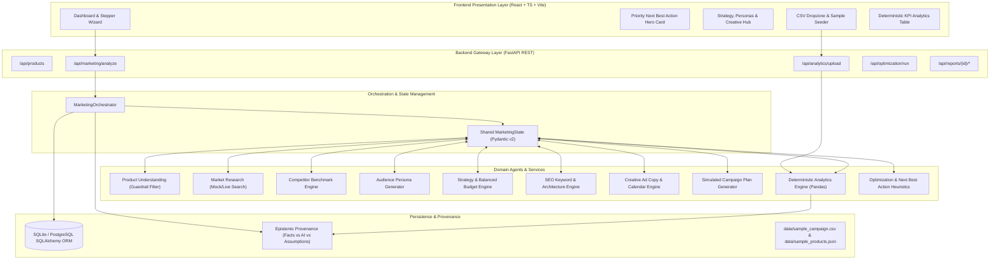

# System Architecture & Technical Design

## 1. Overview

The **AI-Powered Digital Marketing Strategist & Optimization Agent** is an end-to-end full-stack agentic system engineered for high-end niche consumer brands (demonstrated with **Herbally Neem Infused Bedding**). 

The platform departs fundamentally from naive prompt-in/text-out LLM wrappers by coupling **typed state machines**, **deterministic arithmetic**, **epistemic grounding**, and **actionable heuristic decision loops**.

---

## 2. Mermaid System Architecture Diagram

---

## 3. Core Architectural Subsystems

### 3.1 Synchronous Monolith vs. Autonomous Loops
To prevent unbounded recursion, state corruption, or nondeterministic failure mid-workflow, the system uses a single synchronous `MarketingOrchestrator` coordinating typed functional services. Each step takes and updates an immutable snapshot of `MarketingState`.

### 3.2 Epistemic Classification Engine
Every insight or recommendation rendered to the end-user is tagged with an epistemic category:
1. `VERIFIED_FACT`: Grounded in confirmed brand product specifications (GOTS certifications, verified botanical wash properties).
2. `EXTERNAL_RESEARCH`: Empirical market data and benchmark studies.
3. `AI_RECOMMENDATION`: Model-synthesized strategies, channel allocations, and ad copy variants.
4. `ASSUMPTION_OR_ESTIMATE`: Working hypotheses (target personas, estimated search volume, cost estimates).

### 3.3 Zero-Division Deterministic Math
All metric computations ($CTR = \frac{Clicks}{Impressions} \times 100$, $CPC = \frac{Spend}{Clicks}$, $CPA = \frac{Spend}{Conversions}$, $ROAS = \frac{Revenue}{Spend}$) are strictly calculated in Python using protected floating-point arithmetic with safe division guards. The LLM is never invoked for arithmetic calculations.

### 3.4 Non-Negotiable Medical Claim Guardrails
The system implements regex-based guardrail filtering checking for prohibited medical assertions (e.g., curing eczema, treating insomnia, medical therapies) before outputting ad copy or product benefit summaries.
