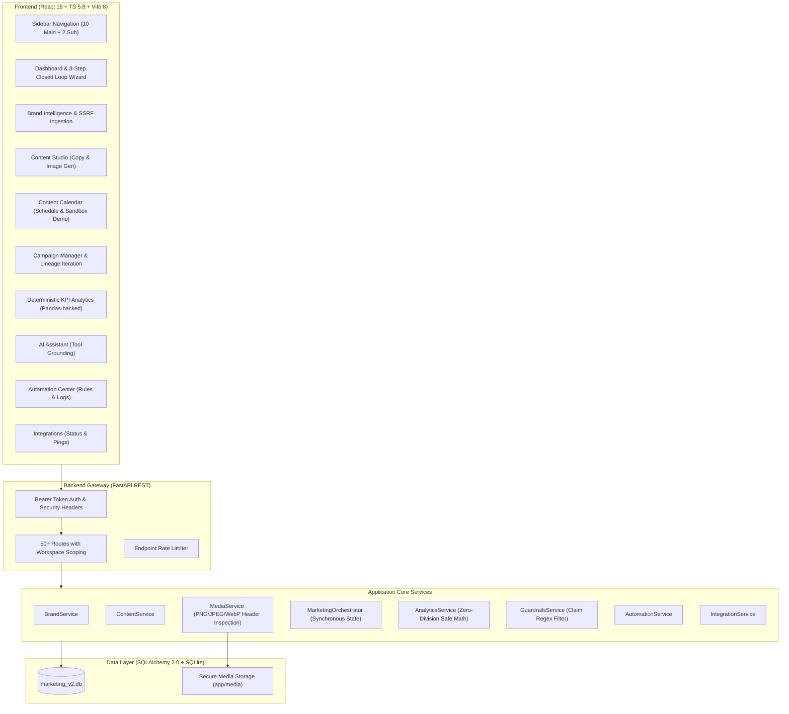

# Universal AI Marketing Automation Platform — Audit & Reference Workflow Report
**Target Workspace:** `c:\DM`  
**Evaluation Standard:** Zero paid API calls, verified REA reverse-engineering tools, non-destructive audit, preservation of existing code and uncommitted changes.

---

## 1. REA Tools & Environment Verification

| Check Item | Status | Verification Detail |
| :--- | :--- | :--- |
| **REA Skill** | **Verified** | Installed at [SKILL.md](file:///C:/Users/sanja/.gemini/config/skills/reverse-engineer-anything/SKILL.md) (v42, 207 registered tools). |
| **REA MCP Server** | **Active & Responsive** | Verified live via MCP call `list_unknowns` on server `rea` returning `{"result":{"items":[],"total":0,"offset":0,"next_offset":null}}`. Schemas present in `C:\Users\sanja\.gemini\antigravity-ide\mcp\rea\`. |
| **Web & Target Inspection** | **Verified** | Public live endpoints investigated via live web extraction (`read_url_content` and web search) for `scalio.app` and `almostzero.io`. |
| **Engines Required** | **None** | Source and public web inspection required no native decompilation engines (Ghidra/IDA/JADX skipped per policy). |

---

## 2. Repository Audit (`c:\DM`)

### 2.1 Git Status & Workspace Integrity
- **Branch:** `main` (synchronized with `origin/main`).
- **Uncommitted Changes:** 31 tracked files modified (`+1024 / -193`), plus 13 untracked security and media files (`middleware.py`, `media_service.py`, `authorization_service.py`, `rate_limit_service.py`, `test_security_media.py`, etc.).
- **Preservation Status:** All uncommitted changes and existing architecture have been preserved completely untouched.

### 2.2 Automated Verification Baseline
- **Backend Tests:** **39 of 39 passed** in 5.84s (`pytest -v` in `backend/`).
  - Covers deterministic zero-division metrics math, AYUSH/FDA medical claim guardrails, SSRF host rejection, closed-loop campaign state machines, bearer authentication, workspace isolation, rate limiting, and safe media delivery.
- **Frontend Build Check:** **Passed** (`tsc -b && vite build` built clean bundle in 2.61s with 0 errors).

### 2.3 Architecture & Implementation Inventory

### 2.4 Verified Features vs. Gaps & Technical Debt

| Area | Current State | Verification / Limitation |
| :--- | :--- | :--- |
| **Workspace Isolation & Multi-Tenancy** | **Implemented** in [authorization_service.py](file:///c:/DM/backend/app/services/authorization_service.py) | Scopes brands, content, automation, and media. Rejecting cross-workspace access is tested and passing. |
| **Brand Profile** | **Partially Generic** | [brand.py](file:///c:/DM/backend/app/models/brand.py) has columns for voice, colors, and claims, but default column values and several routes hardcode `"herbally-brand"` / `"Herbally"`. |
| **Product Catalog** | **Partially Implemented** | [product.py](file:///c:/DM/backend/app/models/product.py) lacks a `workspace_id` and foreign key to `BrandProfile`. Products are mapped loosely by brand string name. No image upload for products. |
| **Image Generation** | **Implemented** | [media_service.py](file:///c:/DM/backend/app/services/media_service.py) enforces header-based format validation, dimension limits, path-traversal prevention, prompt guardrail checking, and graceful unconfigured states. |
| **Video Creation** | **MISSING** | No video provider interface, no background video generation job queue, no duration/aspect ratio video settings, no video player or studio UI. Only text `reel_script` copy exists. |
| **Business Onboarding** | **MISSING** | No unified onboarding wizard (2-minute quick setup for any brand/industry). Navigation assumes the user is already configured. |
| **Asset Library / Media Hub** | **Incomplete** | Media assets are only queried via individual content asset IDs. There is no central Media Library view for all brand photos and generated assets. |
| **Social / Ad Publishing** | **Simulated Sandbox** | Safe by design (`SIMULATED_RUNNING` and `PUBLISHED (Demo)`), preventing accidental ad spend or unauthorized API calls. |

---

## 3. Reference Workflow Investigation (Phase 1)

### 3.1 Scalio-Inspired Creative Studio Workflow (`scalio.app`)
*Evidence gathered from live public pages: `scalio.app`, `scalio.app/reel-maker`, and product documentation.*

1. **Product Positioning:** "Run marketing 24/7" — turning single product or storefront photos into studio photoshoots, multi-lingual Reels, social posts, and ad variations.
2. **Product Photography Studio:**
   - Input: Clean single photo (upload from smartphone or web).
   - Operations: AI background removal, studio lighting, contextual/lifestyle scene generation, on-model fashion try-ons.
   - Guardrail: Preserves physical product fidelity while modifying surrounding set.
3. **Reel Maker & Video Generation Workflow:**
   - **Step 1 (Format Selection):** Proven high-converting formats (Product Hero, UGC Testimonial, Before/After, Recipe/Demo, ASMR, GRWM, Mirror Outfit Check).
   - **Step 2 (Input & Presenter):** Upload/select product image + choose optional AI actor/presenter persona from library.
   - **Step 3 (Pacing, Audio & Settings):**
     - *Aspect Ratios:* **9:16** (vertical Reels/Shorts/Stories) and **16:9** (landscape display/video ads).
     - *Durations:* Base generation typically produces 5s–10s clips, assembled into 15s–60s reels. Configurable targets: 4s, 8s, 12s, 25s.
     - *Languages:* English, Hindi, and regional variations (Bengali, Telugu, Marathi, Tamil, Urdu, Gujarati, Kannada, Odia, Punjabi).
   - **Step 4 (Async Processing & Preview):** Video rendering takes 45–60s in the cloud. User receives progress status, result preview with caption overlay, and direct download/schedule.
4. **Subscription & Credit Model:** Starter ($29.99/mo, 60 credits, 30 posts, 10 stories), Professional ($49.99/mo, 200 credits, 30 posts, 25 stories, website builder, AI replies).

### 3.2 AlmostZero-Inspired Marketing Automation Workflow (`almostzero.io`)
*Evidence gathered from live public pages: `almostzero.io` and Shark Tank India feature documentation.*

1. **Product Positioning:** "Agency-level results at the price of chai" (Meta Ads from ₹999/mo).
2. **Guided 2-Minute Onboarding Workflow:**
   - Eliminates Meta Ads Manager complexity through a minimal questionnaire:
     - **Business Info:** Name, industry, website/storefront URL.
     - **Primary Goal:** Online sales/conversions, WhatsApp inquiries, lead generation, or store footfall.
     - **Budget Range:** Daily/monthly spend capacity with clear minimums.
     - **Target Market & Geography:** Local city, regional metros, or nationwide.
3. **Automated Campaign Architecture:**
   - Automated creation of campaign structure: Objective selection, audience interest clustering, ad set grouping, and copy/creative generation.
4. **Human Review & Approval Gate:**
   - Platform prepares complete campaign draft; user explicitly reviews creative, copy, audience, budget, and channel before clicking "Publish" or activating the campaign.
5. **Continuous Optimization:**
   - Daily KPI evaluation (CTR, CPC, CPA, ROAS), flagging fatigue and generating iterated campaign variants with explicit lineage.

---

## 4. Feature Gap Analysis & Target Architecture

| Capability | Scalio Reference | AlmostZero Reference | Existing `c:\DM` | Target Universal Implementation | Priority |
| :--- | :--- | :--- | :--- | :--- | :--- |
| **Brand Agnosticism** | Any industry (ecom, salon, food, gym) | Any small business (boutique, restaurant, D2C) | Herbally bedsheets hardcoded in defaults and UI | True multi-tenant dynamic brand & product catalog | **P0** |
| **Guided Onboarding** | Product & style onboarding | 2-minute "Business, Goal, Budget" wizard | Manual separate tab entry | Unified Universal Onboarding Flow (`/onboarding`) | **P0** |
| **AI Product Photography** | Background change, lifestyle, studio | Creative generation included | OpenAI Images API adapter (text-prompt only) | Image-to-Image / Studio scene composition adapter | **P1** |
| **AI Video Studio** | Reel Maker (9:16, formats, languages, duration) | AI video ads included | Text reel scripts only | Dedicated Video Studio with async job lifecycle | **P1** |
| **Asset Library** | Organization-wide media storage | Asset repository | Hidden behind content assets | Unified Media Library with filtering and download | **P1** |
| **Campaign Planner & Approval** | Multi-channel social + ads | 2-step setup + 1-click approval | 8-step closed loop with simulated approvals | Real approval gate with detailed spend/audience preview | **P2** |
| **Content Calendar & Automation** | 30 scheduled posts/mo + auto-replies | Daily automated optimization | Working calendar + rule engine | Integrated calendar + triggered draft generation | **P2** |
| **Deterministic Analytics** | Basic performance reporting | Daily optimization tracking | Python/Pandas zero-division KPI engine | Preserved & enhanced with live/simulated source badges | **P2** |

---

## 5. Phased Implementation Roadmap

- **Milestone 1: Foundation & Universal Decoupling (P0)**
  - Decouple hardcoded Herbally brand and product defaults across backend models, routes, services, and frontend state.
  - Establish workspace-scoped multi-brand & multi-product models with product image storage.
  - Implement Universal Business Onboarding flow (Business Name, Industry, Website, Goal, Audience, Geography, Language, Budget).
  - Add comprehensive regression and multi-tenancy tests.
- **Milestone 2: Media Asset Library & Image Studio (P1)**
  - Centralized Media Library view (upload, preview, delete, filter by type).
  - Product photography studio with lifestyle/studio presets.
- **Milestone 3: AI Video Studio & Reel Maker (P1)**
  - Video Studio UI with aspect ratios (9:16, 16:9), durations (4s, 8s, 12s, 25s), multi-language settings, and background job queue.
- **Milestone 4: Campaign Planner & Human Approval Gate (P2)**
  - Multi-channel campaign drafts, audience targeting, and pre-spend review gate.
- **Milestone 5: Calendar, Automations & Analytics Hardening (P2)**
  - Drag-and-drop schedule planner, triggered draft workflows, and verified analytics provenance.
